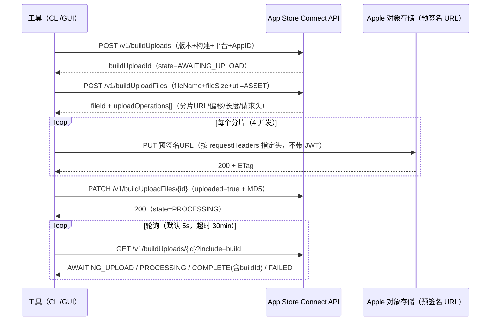

# asc-uploader 设计文档

> 版本：4.0.0 ｜ 更新：2025-10 ｜ 适用仓库：asc-uploader（Go + Wails + Vue）

本文档描述项目的整体架构、模块设计、核心流程与关键决策，供维护者与二次开发者阅读。

---

## 1. 背景与目标

### 1.1 背景

Apple 于 2025 年在 App Store Connect API（v4.1+）中新增了 **buildUploads** 系列端点，首次允许第三方在不依赖 Xcode / Transporter / macOS 的情况下直接上传构建（.ipa / .pkg）。此前 Windows 用户只能借助 Transporter（体验差、无法 CI 化）或黑盒工具。

### 1.2 目标

- **可用性**：Windows 普通用户双击即用（原生窗口、无需管理员权限、零运行时依赖）
- **工程化**：纯 Go CLI 支持跨平台与 CI/CD 集成
- **正确性**：严格遵循 Apple 官方协议（JWT/分片/校验和/状态机），错误信息可指引排查
- **可测试**：全部业务逻辑可离线端到端验证（内置 Mock 服务器）

### 1.3 非目标

- 不做 TestFlight 分发管理、构建号自动递增等上游功能（可在此基线上扩展）
- 不支持 App Store Connect API 之外的通道（如 Transporter 的 iTMSTransporter 协议）

## 2. 总体架构

```
┌─────────────────────────────────────────────────────────────────┐
│                        asc-uploader                             │
│                                                                 │
│  ┌── cmd/asc-uploader-cli ──┐        ┌── main.go (Wails GUI) ─┐ │
│  │  纯 Go CLI               │        │  原生窗口 / --web 兜底  │ │
│  │  upload/apps/status/list │        └──────────┬─────────────┘ │
│  └──────────┬───────────────┘                   │               │
│             │            ┌──────────────────────┴────────────┐  │
│             │            │ internal/webui（本地 HTTP 服务）    │  │
│             │            │  /api/* 接口 + 内嵌前端静态资源     │  │
│             │            │  frontend/ = Vue3 + Element Plus   │  │
│             │            └──────────────┬────────────────────┘  │
│             ▼                           ▼                       │
│  ┌───────────────────────────────────────────────────────────┐  │
│  │ internal/uploader（六阶段上传编排 + JobManager）           │  │
│  └──────────────┬────────────────────────────────────────────┘  │
│                 ▼                                               │
│  ┌────────────────────────────────────────────────────────┐    │
│  │ internal/ascapi（API 客户端：JWT/重试/分片上传）        │    │
│  └──┬──────────────┬──────────────────────────────────────┘    │
│     ▼              ▼                                           │
│  internal/jwt   internal/ipa   （net/http）                     │
│  ES256 签发     zip→Info.plist                                  │
│                    │                                            │
│                    ▼                                            │
│                internal/plist（bplist00 + XML 解析）            │
└─────────────────────────────────────────────────────────────────┘
```

**分层原则**：

| 层 | 包 | 职责 | 依赖 |
| --- | --- | --- | --- |
| 入口层 | cmd/*、main.go | 参数解析、展示、进程管理 | 业务层 |
| 服务层 | webui、uploader | HTTP 接口、任务编排与状态机 | 领域层 |
| 领域层 | ascapi、ipa、jwt、plist | Apple API 协议、包解析、认证 | 仅标准库 |
| 测试设施 | mockasc、testutil | 模拟服务器、夹具构造 | 领域层 |

CLI 与 GUI **共用同一条上传流水线**（`uploader.Run`），只是进度展示方式不同——保证两种形态行为完全一致。

## 3. Apple 官方上传协议（对接细节）

工具实现的官方五步流程（[POST /v1/buildUploads](https://developer.apple.com/documentation/appstoreconnectapi/post-v1-builduploads)）：



关键协议点：

1. **认证**：所有 /v1/* 请求带 `Authorization: Bearer <ES256 JWT>`；分片上传的预签名 URL **不带 JWT**，只按 `uploadOperations[].requestHeaders` 指定的头发送
2. **state 字段二义性**：可能为字符串（`"PROCESSING"`）或对象（`{"state":"FAILED","errors":[...]}`），ascapi 的 `parseState` 两种都兼容
3. **校验和**：提交时必须给出整个文件的 MD5（Apple 侧拼接分片后比对）
4. **UTI**：.ipa → `com.apple.ipa`；.pkg → `com.apple.pkg`；`assetType` 固定 `ASSET`
5. **平台枚举**：IOS / MAC_OS / TV_OS / VISION_OS

## 4. 模块设计

### 4.1 internal/jwt —— ES256 Token 签发

- 输入：.p8 文件（PKCS#8 PEM 的 EC P-256 私钥）+ Key ID；团队密钥另需 Issuer ID
- 两种 payload（官方《Generating Tokens for API Requests》）：团队密钥 `{iss,iat,exp,aud}`；个人密钥 `{sub:"user",iat,exp,aud}`——**不使用 Issuer ID**
- 输出：`header.kid` + `payload{iss,iat,exp,aud=appstoreconnect-v1}` + **r||s 原始 64 字节签名**（JWT 规范要求，非 ASN.1 DER）
- 有效期 18 分钟（Apple 上限 20 分钟），到期前 2 分钟自动重签；`Token(force)` 支持服务端 401 后强制刷新
- 并发安全（互斥锁保护缓存）

### 4.2 internal/plist —— plist 解析器

- **二进制 bplist00**：完整实现 marker 体系（null/bool/int 1~16 字节/real/date/ASCII/UTF-16BE/UID/array/dict）。字典 0xC0 与 0xD0 均为「先全部 key 引用、后全部 value 引用」；`0x0F` 扩展长度遵循 `0x10|log2(size)` 编码
- **XML**：轻量正则提取本工具关心的扁平键值 + `CFBundleSupportedPlatforms` 数组
- 不引入第三方依赖（如 howett.net/plist），保持零依赖与可审计性

### 4.3 internal/ipa —— 安装包信息读取

- 标准 archive/zip 打开 → 正则 `^Payload/[^/]+\.app/Info\.plist$` 匹配候选 → **取路径最短者**（规避内嵌框架 / App Clip 等 decoy 的同名 Info.plist）→ plist 解析出 BundleID / 版本 / 构建
- .pkg 无 Info.plist：调用方要求用户手动填版本号

### 4.4 internal/ascapi —— API 客户端

- `Client.do()` 统一请求管线：
  - 401（首次）→ 强制重签 Token 重试
  - 429 / 5xx → 指数退避（1s/2s/4s），最多 4 次尝试
  - 4xx（其余）→ 立即失败，解析 Apple JSON:API 错误结构为 `*ascapi.Error`（附中文 `Hint()`）
- `ExecuteUploadOps()` 分片并发上传引擎——固定 4 worker；≤64MiB 分片整块进内存，更大分片 `io.NewSectionReader` 流式；单分片失败指数退避重试 4 次；任一分片最终失败即整体失败
- `FileMD5()` 流式计算全文件 MD5

### 4.5 internal/uploader —— 上传编排（核心）

`Run(ctx, Config, Request, Hooks) (*Result, error)` 同步执行六阶段：

```
prepare → session → reserve → upload → commit → wait(可选) → Result
```

- **Hooks**：`Phase(phase)` / `Log(msg)` / `Progress(done,total,speedEMA)`——CLI 用它驱动控制台进度条，GUI 的 JobManager 用它维护轮询快照
- 速度为 EMA（0.6/0.4 平滑），避免瞬时抖动
- 取消：ctx 取消后任意阶段统一返回 `ErrCanceled`（区别于失败）
- `--no-wait`：commit 成功即返回（字节已全部上传，Apple 异步处理）
- `JobManager`：GUI 用后台任务壳——单任务互斥、`Snapshot()` 产出线程安全的 JSON 快照（state/bytes/speed/logs/result）

### 4.6 internal/webui —— GUI 本地服务

安全设计：`Server.Handler()` 自带本地访问校验（详见 §7）——Host 必须为回环地址，携带 Origin 时必须在白名单内，跨域响应头按 Origin 回显而非通配。

一套 Handler 服务两种运行形态：

| 形态 | 前端来源 | /api 通路 |
| --- | --- | --- |
| 原生窗口（默认） | Wails/WebView2 加载内嵌资源 | **真实 127.0.0.1 随机端口 HTTP 服务**（CORS 放开） |
| --web 兜底 | 同一端口直接服务 | 同源 |

设计决策——**原生模式下 /api 为什么走真实回环端口**：Wails 在 Windows 通过 WebView2 的 WebResourceRequested 拦截 + IStream 转发请求体，大文件 multipart（拖拽上传 .ipa 几十~几百 MB）在该链路上不可靠（历史实测丢字节/挂起）。改为真实 socket 后与浏览器版完全同一代码路径；前端通过 `/api-config.js`（`window.__ASC_API_BASE`）在启动时发现 API 地址。

HTTP 接口（前后端契约）：

| 方法 | 路径 | 说明 |
| --- | --- | --- |
| POST | /api/key-file | 上传 .p8 到临时目录，返回本机路径 |
| POST | /api/ipa?name= | 上传安装包（multipart 流式落盘），返回解析信息 |
| POST | /api/parse-path | 按本机路径解析安装包 |
| POST | /api/apps | 用凭据拉取 App 列表（测试连接） |
| POST | /api/start | 启动后台上传任务（JobManager） |
| GET | /api/job | 任务快照（前端 600ms 轮询） |
| POST | /api/cancel | 取消当前任务 |

### 4.7 frontend —— Vue 3 + Element Plus

- Vite 5 + `@vitejs/plugin-vue`，产物输出至 `internal/webui/dist` 由 `go:embed` 内嵌
- `App.vue`（Composition API）：三卡片布局（密钥与 App → 安装包 → 上传）；`el-steps` 六阶段步骤条、条纹流动进度条、`el-descriptions` 包信息、`ElMessage` 反馈
- localStorage 记忆连接信息（不含 apiBase）
- 拖拽上传走 XHR（带本地进度），路径模式走 fetch

### 4.8 internal/mockasc —— Mock 服务器

Go 实现的「假 Apple」，与真实接口逐条对应（见 §3），并做严格校验：

- 所有需鉴权端点：完整 ES256 验签（alg/kid/iss/aud/exp/20 分钟上限/签名）
- 分片上传：禁止携带 Authorization；Content-Type 必须遵守 requestHeaders；字节数必须与分片声明一致
- 提交：按分片序号拼接全文、MD5 与声明值比对
- 状态机：AWAITING_UPLOAD →（提交）PROCESSING →（第 N 次轮询）COMPLETE + buildId
- `Violations()` 输出协议违规记录（测试断言必须为空）

## 5. GUI 启动加固（普通权限可用）

历史教训：v3.0 在部分机器上普通权限「无响应」——根因是 WebView2 数据目录不可写时直接退出，而 GUI 程序的 stderr 无人可见。v4.0 的四层加固：

1. **WebView2 运行时预检**：缺失时弹窗给微软官方安装链接（用户级安装，无需管理员）
2. **数据目录多候选 + 真实写探测**：环境变量 → %LOCALAPPDATA% → %APPDATA% → exe 旁 .webview2-data → 临时目录，逐个实际写入探测文件
3. **失败必弹窗**（MessageBoxW）：任何启动失败给出明确原因
4. **一键降级**：弹窗选「是」自动以 --web 重启自身

manifest 为 `asInvoker`（不请求提权）；未签名 exe 可能被 SmartScreen 提示属正常。

## 6. 测试策略

| 层次 | 内容 |
| --- | --- |
| 单元（plist） | testutil 自带 **bplist 编码器**，与解析器做往返断言（含 UTF-16 中文、嵌套、bool/int/float/数组）；XML 用例 |
| 单元（jwt） | 生成 EC P-256 → 签发 → 用公钥 ecdsa.Verify 验签；断言 header/payload/TTL/缓存/force 重签；非法密钥（非 PEM/非 EC/不存在） |
| 单元（ascapi） | httptest：500→成功退避、401→force 重签、403 错误结构与中文提示、400 不重试 |
| 单元（ipa） | 构造含 decoy 嵌套 .app 的 zip，断言选中最短路径主 App |
| **端到端** | mockasc + 真实密钥 + 真实构造 IPA：完整流水线（8 分片并发、MD5、PROCESSING→COMPLETE→BuildID、阶段顺序、协议零违规）；no-wait 路径；错误密钥 401 链路；webui HTTP 接口全链路；历史上传查询 |

CI 建议：`go vet ./... && go test ./...`（约 15s，全离线）。

## 7. 安全设计

- 私钥仅在本机读取用于签发 JWT；网络出口只有 `api.appstoreconnect.apple.com`（或用户显式指定的 apiBase，用于联调）
- 本地 GUI 服务只监听 `127.0.0.1`；原生窗口模式的 API 端口随机。服务端执行 **Host 回环 + Origin 白名单**校验（127.0.0.1 / localhost / ::1 / wails.localhost），阻止恶意网页对本地接口发起 CSRF 或 DNS rebinding 攻击；无 Origin 的请求（WebView2 原生窗口、curl、测试）放行
- 上传到服务的 .p8 / .ipa 落在系统临时目录（`asc-ui-*.p8/ipa`），随 OS 临时清理策略回收
- 不收集任何遥测

## 8. 已知限制与路线图

- 分片并发固定 4（Apple 分片大小由服务端决定，通常 8~64MiB，4 并发对家用带宽已饱和）
- `ListApps` 一次拉 200 个（未翻页），超大团队需扩展
- 路线图：上传历史持久化（GUI）、多密钥配置管理、构建号冲突自动检测、CI 示例（GitHub Actions）、暗色主题

## 9. 版本演进

| 版本 | 形态 | 说明 |
| --- | --- | --- |
| v1.x | Node.js 单文件 CLI | 零依赖 mjs，25/25 测试通过（已被 Go CLI 取代） |
| v2.x | Go+Vue 浏览器版 | 本地 HTTP + 系统浏览器 |
| v3.x | Wails 原生窗口 | WebView2；v3.1 修复普通权限无响应 |
| **v4.0** | **项目化重构** | 纯 Go CLI + Wails GUI 共用流水线；Mock/测试/文档完整化（本仓库） |
